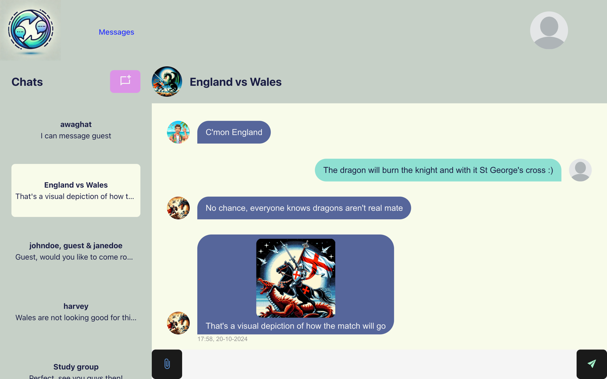
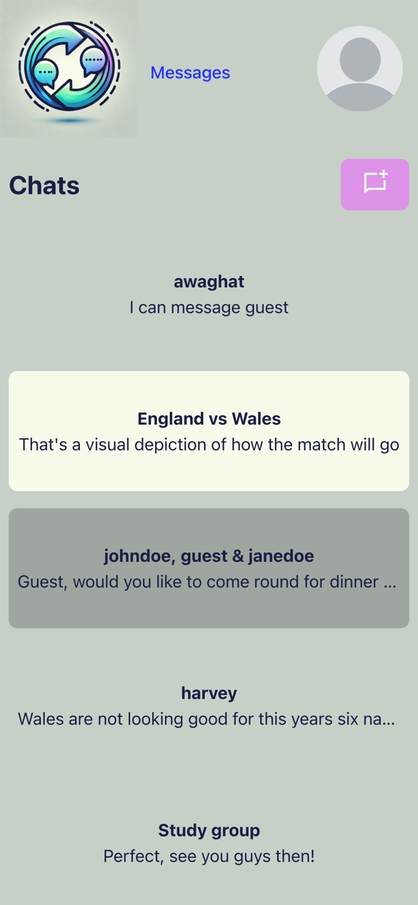
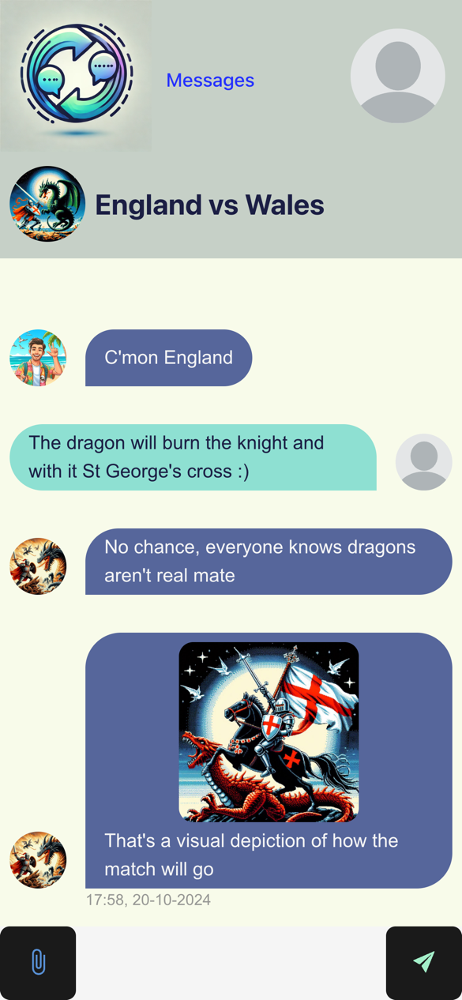

# **EasyMessage - Messaging App (Frontend)**

[](https://github.com/kiffoh/messaging-app-frontend/actions/workflows/ci.yml)

## Table of Contents
- [Introduction](#introduction)
- [Features](#features)
- [Demo](#demo)
- [Technologies Used](#technologies-used)
- [Getting Started](#getting-started)
  - [Prerequisites](#prerequisites)
  - [Installation](#installation)
  - [Environment variables](#environment-variables)
  - [Running the Application](#running-the-application)
  - [Scripts](#scripts)
- [Usage](#usage)
- [Folder Structure](#folder-structure)

## Introduction
**EasyMessage** is a real-time direct and group messaging web app, inspired by WhatsApp. Users can hold one-to-one and group conversations, manage their profile, and share media. This is the frontend, the final part of the [Odin Project](https://www.theodinproject.com/lessons/nodejs-messaging-app) curriculum.

The frontend is built with React and talks to the backend over a REST API (via Axios) and Socket.IO, so messages sent by one user appear for others without a page refresh. The layout switches between mobile and desktop breakpoints using CSS media queries, with a JS-driven toggle on narrow screens for when there isn't room to show the chat list and an open chat side by side.

Chat state lives in a reducer (`src/chats/chatsReducer.ts`) exposed through a chats context, and the Socket.IO listener dispatches into it, so incoming messages are applied in one place and duplicates or events for chats you aren't in are ignored. Two more React Contexts cover authentication (decoding and validating the JWT stored in `localStorage`) and the Socket.IO connection.

## Features

- 🔐 **Secure Authentication**: JWT-based user authentication
- 💬 **Real-time Messaging**: Instant message delivery using Socket.IO
- 👥 **Group Chats**: Support for multiple users in conversations
- 📸 **Media Sharing**: Image upload and sharing capabilities
- 👤 **User Profiles**: Customisable user profiles with avatars
- 📩 **Direct Messages**: One-to-one private conversations
- 📱 **Responsive design**: for mobile and desktop

# Demo
[The website is live](https://messaging-app-client-eight.vercel.app/). Log in with the demo credentials to explore the features of the full-stack application:
- **username**: guest
- **password**: iamaguest

### Screenshots

A group chat with an image message on desktop:



On narrow screens the app switches between the chat list and the open chat:

<p>
  
  &nbsp;
  
</p>

## Technologies Used
- **Frontend Framework**: React with TypeScript
- **Styling**: CSS Modules and In-Line CSS
- **Routing**: React Router
- **Real-time Communication**: Socket.io
- **Build Tool**: Vite
- **API**: Axios for HTTP requests
- **Testing**: Vitest and React Testing Library for unit tests, Playwright for end-to-end smoke tests
- **CI**: GitHub Actions

## Getting Started

### Prerequisites
Ensure the following software is installed before proceeding:
- **Node.js** (v22, see `.nvmrc`)
- **npm**

### Installation
1. Clone the repository:
   ```bash
   git clone https://github.com/kiffoh/messaging-app-frontend.git
   ```
2. Navigate to the project directory:
```bash
cd messaging-app-frontend
```
3. Install dependencies:
```bash
npm install
```

### Environment variables
Copy `.env.example` to `.env` and fill in the values:
- `VITE_SERVER_URL`: origin of the backend API (also used for the Socket.IO connection)
- `VITE_EDIT_LOGO`: URL of the pencil icon on the profile page
- `VITE_DEFAULT_PICTURE`: avatar shown when a user has no photo

### Running the Application
To start the development server, run:
```bash
npm run dev
```
Open your browser and go to the port specified.

### Scripts
| Script | What it does |
| --- | --- |
| `npm run dev` | Start the Vite dev server |
| `npm run build` | Type-check, then build for production |
| `npm run preview` | Serve the production build |
| `npm run typecheck` | Type-check with `tsc --noEmit` |
| `npm run lint` | Lint with ESLint |
| `npm test` | Run the unit tests (Vitest) |
| `npm run test:watch` | Run Vitest in watch mode |
| `npm run test:e2e` | Run the Playwright smoke tests (run `npx playwright install chromium` first) |

## Usage
### Messaging
- **Real-time Chat:** Users can send and receive messages in real time using Socket.io. Conversations are organised into either group chats (3+ members) or direct messages (1-to-1).

### CRUD for Messaging
- **Create, Read, Update, Delete (CRUD):** Users can send, edit, and delete messages. Clicking a message reveals edit and delete options. Only the message author has access to the delete and update options for their own messages.

### CRUD for Profiles and Groups
- **User Profiles:** Users can create accounts, edit their profile information (username, bio, and photo), and delete their own profiles.
- **Group Profiles:** Group profiles can be created by any user. Group admins (or the group creator) can edit or delete the group profile, including the group name, bio, and profile photo.

### Mobile-Friendly Messaging
- **Responsive Design:** Below a 550px width, the interface switches between a chat list view and an open chat view via a CSS media query, since there isn't enough space to show both at once.

### Image and Attachment Support
- **Sending Images and Attachments:** The message input form supports uploading images and attachments.

### Additional points
- **Message Timestamps:** Hovering over messages reveals the timestamps, allowing users to track the conversation history. If a message has been edited, the timestamp will display "Last edited" instead of the original creation time.

- **Contact Addition:** Contacts are added from a searchable list of existing users, excluding anyone already in your contacts.

## Folder Structure
```bash
/src
    /authentication      # Auth context and useAuth hook (token validation)
    /chats               # Chats reducer, context, useChats and the socket listener
    /components          # UI components, one folder each
    /functions           # Pure helper functions
    /hooks               # Shared hooks (useMediaQuery, useAutoClearingState)
    /layouts             # Layouts used for React-Router
    /routes              # URL routes
    /socketContext       # Socket.io context and useSocket hook
    /assets/styles       # Global and override styles
    /types               # Shared domain and API types
    /test                # Vitest setup

    App.tsx                # Chat list and open chat
    ErrorPage.tsx          # Error page component
    Home.tsx               # Shows the app or the login form
    app.module.css         # App-specific CSS
    main.tsx               # React app entry point
    index.css              # Main CSS file for styling the app

/e2e                     # Playwright smoke tests (the backend is mocked)
```
